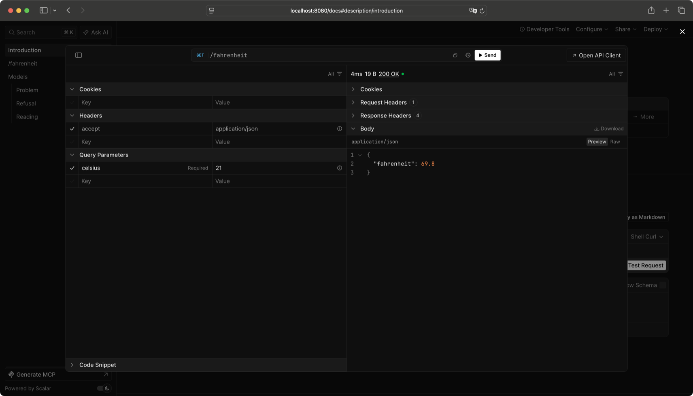

<h1>
  <picture>
    <source media="(prefers-color-scheme: dark)" srcset="docs/assets/logo-dark.svg">
    
  </picture>
</h1>

The Eio-native web framework for modern OCaml.

[](https://github.com/hyphatech/spindle/actions/workflows/ci.yml)
[](https://github.com/hyphatech/spindle/releases)
[](LICENSE)

[](https://hyphatech.io/stack/)

**Documentation**: [hyphatech.github.io/spindle](https://hyphatech.github.io/spindle/)

## Features

- **Interactive docs**: OpenAPI docs via Scalar at `/docs`, generated from your routes.
- **Front end in sync**: schemas for your front end, derived from your OCaml types.
- **Typed end to end**: JSON derived from your types, every input validated.
- **Eio-native**: straight-line handlers on OCaml 5, multicore by design.
- **Battle-tested**: its own HTTP/1.1 engine, every requirement it meets a test: RFC 9112 and 9110 for HTTP, 6455 for WebSockets, 7578 for forms, and RFC 9651's published suite for Structured Fields.
- **Batteries included**: Postgres, WebSockets, sessions, logging, traces and metrics.

## Install

```sh
opam repo add hypha https://github.com/hyphatech/opam-repository.git
opam install spindle
```

Add to your `bin/dune`:

```lisp
(executable
 (name main)
 (libraries spindle eio_main)
 (preprocess (pps ppx_wiretype)))
```

A whole project: [your first app](https://hyphatech.github.io/spindle/tutorial/first-app/).

## Example

```ocaml
open Spindle.Syntax

type bill = {
  total : float; [@min 0.]
  tip : int; [@min 0] [@max 100]  (** percent *)
  people : int; [@min 1] [@max 50]
}
[@@deriving wiretype]

type share = { each : float } [@@deriving wiretype]

let split b =
  let total = b.total *. float (100 + b.tip) /. 100. in
  Ok { each = total /. float b.people }

let routes =
  [
    Spindle.post
      Spindle.Path.(s "split")
      (Spindle.Returns.json share_json)
      (let+ b = Spindle.json bill_json in
       split b);
  ]

let () =
  Spindle.Log.setup ();
  Eio_main.run @@ fun env ->
  Spindle.serve env (routes @ Spindle.Openapi.routes routes)
```

```console
$ curl localhost:8080/split --json '{"total": 90, "tip": 10, "people": 3}'
{"each":33}
```

Open `localhost:8080/docs` for interactive API docs, with nothing to
write: an OpenAPI 3.2 document generated from your routes, served by
[Scalar](https://scalar.com). Every route, its schema with the bounds from
your types, every error it may answer, and a button to try it.



## Contributing

See [AGENTS.md](AGENTS.md).

## Licence

MIT, copyright Hypha Technologies Ltd. See [LICENSE](LICENSE).
